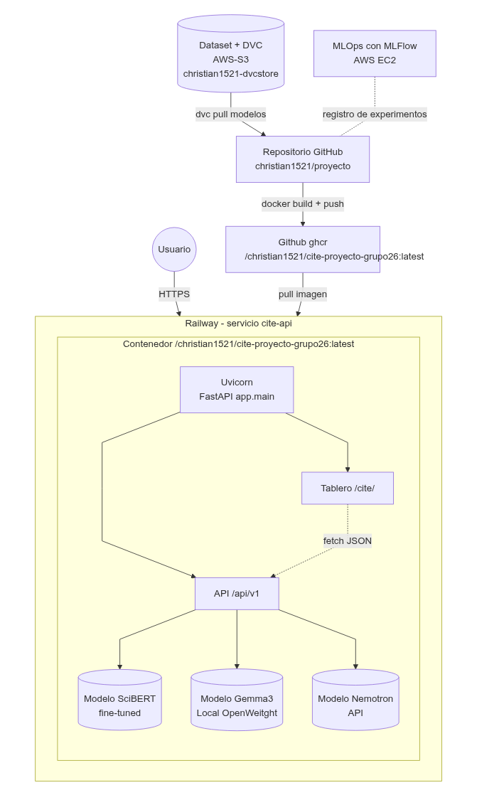

# Vista de desarrollo

## Estructura del repositorio

Repositorio: <https://github.com/christian1521/proyecto>

```apl
https://github.com/christian1521/proyecto
```

```
.
├── .dvc/config                    # Remoto DVC: s3://christian1521-dvcstore
├── app/                           # API + tablero (un solo servicio)
│   ├── main.py                    # FastAPI: página de inicio, router /api/v1, monta /cite
│   ├── api.py                     # Endpoints, catálogo de funciones, carga e inferencia de modelos
│   ├── config.py                  # Settings (/api/v1, CORS, logging)
│   ├── cite/                      # Tablero web
│   │   ├── index.html
│   │   └── favicon.svg
│   └── tests/                     # Pruebas pytest (conftest.py, test_api.py)
├── data/
│   ├── final_labelled_citing_sentences_all.csv.dvc # DVC dataset entrenamiento SCDF
│   ├── model_scibert_citing_sentences.dvc          # DVC del modelo SciBERT (~440 MB)
│   └── model_bert_citing_sentences.dvc             # DVC del modelo BERT (~439 MB)
├── experimentos-mlflow/           # Scripts de experimentos registrados en MLflow
│   ├── scibert_finetuning_v1.py … v4.py
│   ├── experimento_BERT.py
│   ├── experimento_MISTRAL.py
│   └── experimento_QWEN.py
├── dist/                          # Paquete distribuible (.whl, .tar.gz)
├── Dockerfile                     # Imagen única API + tablero (python:3.12)
├── .dockerignore
├── run.sh                         # Arranque Docker con uvicorn app.main:app ${PORT}
├── railway.json                   # Build/deploy en Railway (healthcheck, reintentos)
├── Procfile                       # Arranque estilo PaaS
├── pyproject.toml                 # Paquete citing-sentences-api
├── requirements.txt, test_requirements.txt, typing_requirements.txt
├── tox.ini, mypy.ini
└── README.md
```

### Componentes de mayor tamaño  en Google Drive

```bash
.
├── cache
│   └── chunks.tar.gz
├── dataset
│   ├── dataset.json
│   ├── test.json
│   ├── train.json
│   └── val.json
├── modelos
│   ├── gemma3
│   ├── nemotron
│   └── scibert
└── semillas
  └── arxiv-dataset-semilla-balanceada
```


# Recursos externos en Google Drive

Algunos componentes del proyecto **no se encuentran en este repositorio** por su gran tamaño (modelos, datasets y caché precalculado). GitHub no son adecuados para archivos de varios GB, así que se almacenan en Google Drive.


> **Acceso:** <https://drive.google.com/drive/folders/1U9tPHhoByzL7xWpYjXxXBE5Gz2L8QVeH?usp=sharing>
>
> > Descarga el contenido y colócalo en la **raíz del proyecto**, respetando exactamente la estructura de carpetas de abajo, para que el código, el `Dockerfile` y los scripts encuentren las rutas esperadas.

---

## Componentes de mayor tamaño en Google Drive

```bash
.
├── cache
│   └── chunks.tar.gz
├── dataset
│   ├── dataset.json
│   ├── test.json
│   ├── train.json
│   └── val.json
├── modelos
│   ├── gemma3
│   ├── nemotron
│   └── scibert
└── semillas
    └── arxiv-dataset-semilla-balanceada
```


## Descripción de cada carpeta

### `cache/`
| Archivo         | Descripción                                                  |
| --------------- | ------------------------------------------------------------ |
| `chunks.tar.gz` | Caché precalculada de *chunks* (fragmentos de texto procesados) usada por la API para no recalcularlos en cada arranque. Se empaqueta comprimida; el `Dockerfile` la descomprime automáticamente con `ADD cache/chunks.tar.gz ./cache/`, quedando disponible en `/opt/proyecto/cache/chunks` (variable `CACHE_DIR`). |

### `dataset/`
Datos del proyecto en formato JSON.

| Archivo        | Descripción                                                  |
| -------------- | ------------------------------------------------------------ |
| `dataset.json` | Dataset completo, antes de la partición.                     |
| `train.json`   | Partición de **entrenamiento**.                              |
| `val.json`     | Partición de **validación**, para ajustar hiperparámetros y monitorear el entrenamiento. |
| `test.json`    | Partición de **prueba**, reservada para la evaluación final del modelo. |

### `modelos/`
Pesos de los modelos utilizados por el sistema.

| Carpeta     | Descripción                                                  |
| ----------- | ------------------------------------------------------------ |
| `gemma3/`   | Modelo de lenguaje **Gemma 3** servido localmente con **Ollama** para generación de texto. En el despliegue en Railway se descarga durante el build (`ollama pull gemma3:4b`). |
| `nemotron/` | Modelo **NVIDIA Nemotron**, alternativa de LLM para el sistema. |
| `scibert/`  | Modelo **SciBERT** (BERT entrenado sobre literatura científica) usado por la API para el análisis de textos académicos. El `Dockerfile` lo copia a `/opt/proyecto/models/scibert` (variable `MODEL_DIR`). |

### `semillas/`
| Carpeta                             | Descripción                                                  |
| ----------------------------------- | ------------------------------------------------------------ |
| `arxiv-dataset-semilla-balanceada/` | Conjunto *semilla* extraído de **arXiv**, balanceado por clase, a partir del cual se construyen los datasets del proyecto. |

---

## Notas

- Estas carpetas están excluidas del control de versiones mediante `.gitignore`.
- Para construir la imagen Docker, `cache/chunks.tar.gz` y `models/scibert` deben existir localmente antes de ejecutar `docker build`.
- No subas estos archivos al repositorio; si se actualizan, reemplázalos en Google Drive.

## Diagrama de componentes




> **Esquema de desarrollo y despliegue del servicio `\cite-api\`:**
>
> El diagrama ilustra el flujo de desarrollo, despliegue y operación del servicio *cite-api*, alojado en **Railway**. El usuario interactúa vía **HTTPS** con un contenedor Docker (`ghcr.io/christian1521/cite-proyecto-grupo26`), que ejecuta una aplicación **FastAPI** con **Uvicorn**. Esta expone un *tablero* (`/cite/`) y una **API REST** (`/api/v1`), que consume dos modelos de lenguaje *fine-tuned*: **SciBERT** y **BERT**. El tablero recupera datos en formato JSON desde la API.
>
> El código fuente y la configuración residen en un repositorio **GitHub** (`christian1521/proyecto`), donde se construye la imagen Docker y se sube a **DockerHub**. Los modelos y datasets se gestionan con **DVC** en un bucket de **AWS S3** (`christian1521-dvcstore`), mientras que el registro de experimentos de *MLOps* se realiza con **MLFlow** en una instancia **AWS EC2**. Este esquema garantiza un despliegue escalable y un desarrollo colaborativo.


## Diagrama de secuencia del uso


> **Esquema de uso de la aplicación para usuarios finales:**
>
> Este diagrama de secuencias describe el flujo de interacción del usuario con la aplicación *cite-api*. El proceso inicia cuando el **usuario** ingresa un texto (y opcionalmente un párrafo citado) en la interfaz **Web**. Luego, selecciona un modelo de clasificación y hace clic en el botón **"Analizar Cita"**.
>
> La aplicación **Web** envía una consulta a la **API**, especificando el modelo seleccionado. La **API** procesa la solicitud y la reenvía al **Modelo** correspondiente, que analiza el texto y devuelve un **porcentaje de clasificación**. La **API** traduce este resultado en una **descripción de categoría** y lo envía de vuelta a la interfaz **Web**, que finalmente muestra los resultados al usuario. Este flujo garantiza una experiencia intuitiva y eficiente para el análisis de citas.

## Stack tecnológico

| Capa | Tecnología |
| --- | --- |
| Lenguaje | Python 3.14 (imagen); ≥ 3.9 (paquete) |
| Modelos | Transformers ≥ 4.46, PyTorch ≥ 2.13 (CPU) |
| API | FastAPI ≥ 0.115, Uvicorn ≥ 0.32, Pydantic 2 |
| Tablero | HTML + CSS + JavaScript, servido con `StaticFiles` |
| Experimentos | MLflow en AWS EC2 (puerto 8050) |
| Versionado de datos | DVC + S3 |
| Contenedor / registro | Github Container Registry ghcr |
| Despliegue | Railway (PaaS) |
| Pruebas | pytest vía tox |

## Modelos implementados

| Modelo | Identificador |
| --- | --- |
| SciBERT *(fine-tuned)* | `scibert_scivocab_uncased` |
| Gemma3 | `gemma3:4b` |
| Nemotron | `nemotron-3-ultra-550b-a55b` |

Los modelos se cargan de forma diferida en la primera petición. La entrada se trunca a `MAX_LENGTH=512`
tokens. Si llega `cited_paragraphs`, el texto de entrada se arma así:
`"<citing_sentence> CONTEXT: In the text, the [CITATION] tag refers to: <cited_paragraphs>"`.

## Flujo de trabajo

1. Los datos y los modelos se versionan con DVC en S3, y el código se versiona en GitHub.
2. Los experimentos se registran en MLflow.
3. La imagen se construye localmente con los modelos en `data/` y se publica en DockerHub con *tags*
   `v0.x`.
4. Railway despliega el *tag* elegido.

[Volver al inicio](index.md)
